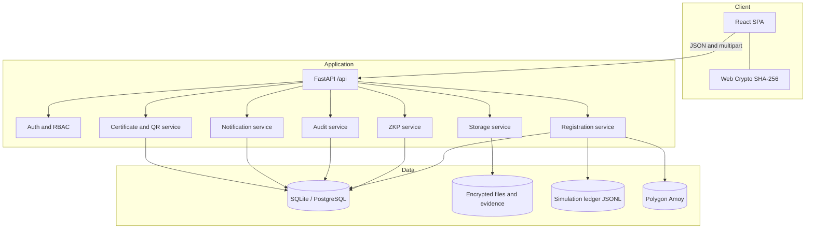
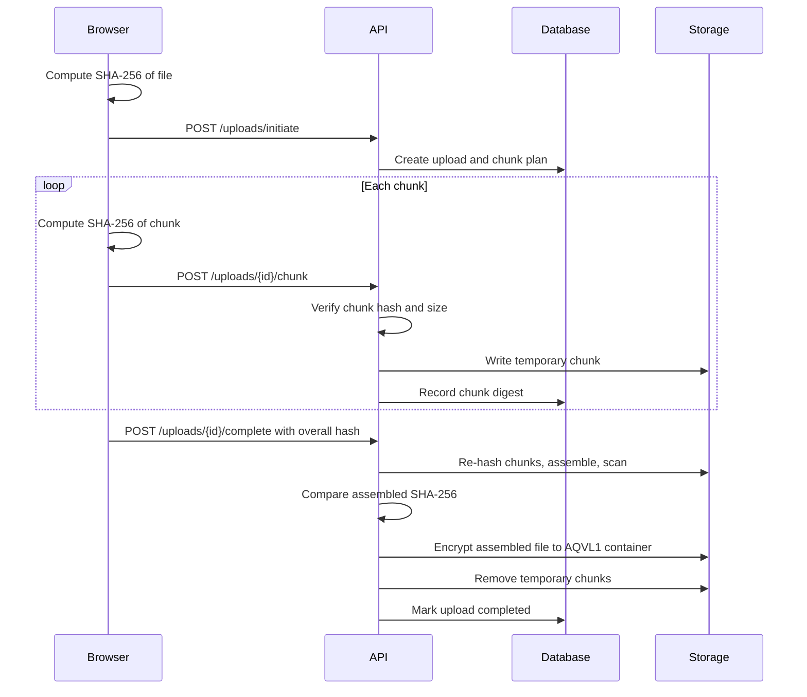
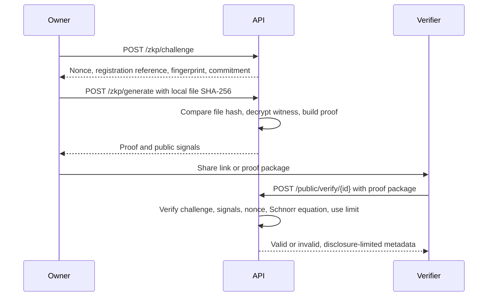

# AUTHENTIQ architecture

## 1. System purpose

AUTHENTIQ records who registered a creative artifact, when it was registered, what bytes it contained, and how ownership changed. It separates three evidence layers:

1. **Content evidence:** SHA-256 over the exact file bytes.
2. **Ownership evidence:** a Poseidon commitment and a zero-knowledge proof that the prover knows the commitment opening.
3. **History evidence:** an append-only ledger plus a hash-chained audit log.

The system is intentionally explicit about what it can and cannot prove. A registration timestamp is priority evidence, not a legal conclusion. The default ledger is a local append-only simulation, not a decentralized blockchain.

## 2. Context diagram



## 3. Runtime components

### 3.1 Single-page application

The client is a React 18 and TypeScript application built with Vite. It has no server-side rendering. Routes are split into public and protected trees:

| Type | Routes |
| --- | --- |
| Public | `/` (landing page), `/login`, `/signup`, `/reset-password`, `/verify/:verificationId` |
| Protected | `/dashboard`, `/register`, `/timeline`, `/registrations/:id`, `/ideas`, `/ideas/:ideaRef`, `/provenance`, `/teams`, `/teams/:id`, `/transfers`, `/disputes`, `/disputes/:id`, `/anonymous-verification`, `/alerts`, `/notifications`, `/audit-logs`, `/settings` |

`/` renders the AUTHENTIQ landing page. It is a static marketing surface with no data access; its account call-to-action hands over to `/signup` and `/login`. The remembered user is only a display cache; the access token is validated through `/api/auth/me` when restoring a session.

### 3.2 Design system

`frontend/src/styles/landing.css` holds the house stylesheet for the landing page and is the origin of the product's visual language. It is loaded before `frontend/src/index.css`, so the palette, the type faces, and the base element rules apply to the workspace screens as well.

| Token | Value | Use |
| --- | --- | --- |
| `--paper` | `#FFFFFF` | Page background |
| `--light` | `#EAEAEA` | Secondary surfaces |
| `--dark` | `#171717` | Ink, borders, primary text |
| `--lime` | `#B7FF00` | Accent, focus, highlights |
| `--muted-foreground` | `#888888` | Secondary text and inactive states |
| `--border` | `#D0D0D0` | Subtle dividers and card edges |

`Funnel Display` is the interface and body face, `Turret Road` is the display face used for headings. Both are self-hosted woff2 files under `frontend/public/fonts`. The Tailwind theme in `frontend/tailwind.config.ts` maps the semantic tokens (background, foreground, card, border, accent, success, warning, destructive) onto the same palette and remaps the legacy blue and violet scales onto ink and lime so every screen matches the landing page without per-page overrides. The product ships a single theme; there is no dark variant and no theme switch, so no surface can drift from the specification.

TanStack Query owns server state. React Hook Form and Zod validate forms. A shared API wrapper adds the bearer token, performs a single-flight refresh on `401`, retries once, and signs the user out if refresh fails. Downloads use authenticated fetch and blob URLs so protected files are not exposed as public URLs.

### 3.3 FastAPI application

`backend/app/main.py` configures CORS, security headers, exception handling, startup lifecycle, health reporting, and route mounting under `/api`. Startup creates directories and database tables, optionally creates demo login accounts, and logs the active ledger mode.

Routers are grouped by domain under `backend/app/api/`:

| Router | Prefix | Responsibility |
| --- | --- | --- |
| Authentication | `/auth` | Accounts, tokens, password reset, sessions |
| Dashboard | `/dashboard` | Aggregated counts and recent activity |
| Uploads | `/uploads` | Chunked upload lifecycle |
| Fingerprints | `/fingerprints` | Server-side SHA-256 generation and comparison |
| Registrations | `/registrations` | Ownership records, files, certificates |
| Versions | `/versions` | Creative version history and comparisons |
| Ideas | `/ideas` | Encrypted idea vault |
| ZKP | `/zkp` | Challenges, proof generation, proof verification |
| Sharing | `/sharing`, `/public` | Silent sharing and public verification |
| Provenance | `/provenance` | AI/human provenance declarations |
| Teams | `/teams` | Team projects and ownership allocation |
| Transfers | `/transfers` | Two-party ownership transfer |
| Disputes | `/disputes` | Dispute workflow and evidence reports |
| Alerts | `/alerts` | Duplicate and similarity alerts |
| Ledger | `/ledger` | Status, transactions, audit |
| Notifications | `/notifications` | In-app inbox |
| Audit | `/audit-logs` | Append-only audit trail and verification |
| Search | `/search` | Cross-entity search |
| Settings | `/settings` | Organization and security capabilities |

### 3.4 Persistence

SQLAlchemy 2.x provides the ORM and session lifecycle. SQLite is the default so the project runs without infrastructure. PostgreSQL is supported through `AUTHENTIQ_DATABASE_URL` using `psycopg`.

Tables are grouped into five domains:

| Domain | Tables |
| --- | --- |
| Identity | `users`, `organizations`, `organization_members`, `user_sessions`, `password_reset_tokens` |
| Registrations | `registrations`, `file_metadata`, `uploads`, `file_chunks`, `commitments`, `zkp_challenges`, `zkp_proofs`, `verification_requests`, `ledger_transactions` |
| Content | `ideas`, `idea_revisions`, `creative_versions`, `ai_provenance` |
| Collaboration | `team_projects`, `team_members`, `contribution_records`, `ownership_allocations` |
| Governance and operations | `ownership_transfers`, `theft_alerts`, `similarity_analyses`, `disputes`, `dispute_evidence`, `notifications`, `audit_logs` |

The schema is created from metadata at startup. There is no migration history in this release.

### 3.5 File storage

Uploads are chunked. The flow is:



The final file is encrypted at rest with chunked AES-256-GCM inside a versioned `AQVL1` container. The encryption key is derived deterministically from `AUTHENTIQ_SECRET_KEY`. Chunks exist as temporary plaintext files between chunk upload and completion; the completion step deletes them. A production deployment should place storage on an encrypted volume and use a dedicated key service.

Dispute evidence follows the same encrypted-container pattern. Idea descriptions, idea notes, and commitment secrets are encrypted as Fernet text fields in the database.

### 3.6 Ledger abstraction

`LedgerAdapter` defines append, chain verification, transaction listing, transaction lookup, and status. Two implementations exist:

- **Simulation ledger:** append-only JSONL at `storage/ledger.jsonl`. Each record contains a block number, previous record hash, payload digest, canonical record hash, transaction type, actor, entity, and payload. `fsync` is called after each append. Verification recomputes block continuity, previous links, record hashes, and payload digests.
- **Polygon adapter:** sends `recordEvent(recordId, recordType, payloadDigest, entityId)` to the Solidity registry using `web3` and `eth-account`, waits for a receipt, and returns the real transaction hash and block number. It never silently falls back to simulation if configuration or connectivity fails.

A `ledger_transactions` table mirrors indexable ledger metadata for application queries. Certificates and UI badges always show whether a record is simulated or on-chain.

### 3.7 Audit chain

Security-relevant actions call `append_audit`. Each audit entry contains:

```text
record_hash = SHA256(previous_hash + canonical_json(entry_body))
```

Entries are ordered by creation time and ID. `GET /api/audit-logs/verify` recomputes the chain and reports the first mismatches. This is tamper-evident, not tamper-proof: an operator with database access can rewrite the whole chain. The chain is a detection mechanism and a review aid.

## 4. Core flows

### 4.1 Registration

1. The browser hashes the selected file locally. Before a single byte is uploaded, `POST /api/registrations/duplicate-check` compares that SHA-256 fingerprint, and for images a canvas-computed dHash-64 perceptual hash, against every stored registration. The interface shows "this file is already in the workspace" with the matching references, timestamps, and whether the match belongs to the same account or organization.
2. The owner completes an upload. The upload must belong to the authenticated user and have `status=completed`.
3. The server creates a registration identifier, computes the Poseidon commitment `C = Poseidon(SHA256(file) mod p, secret)`, generates a Pedersen blinding factor, and encrypts the secret.
4. File metadata, registration metadata, tags, privacy mode, and creation timestamp are stored.
5. Duplicate detection runs again on the server against the stored fingerprint. An identical SHA-256 match creates an exact-duplicate alert for both the existing owner and the new claimant, notifies both parties, and writes an audit event. A dHash-64 similarity of 0.90 or higher creates a similarity alert for the existing owner. The response returns the matches so the interface can name them directly.
6. A registration ledger event is appended. The earlier registration keeps priority because the ledger is ordered by timestamp.
7. The owner can download a PDF certificate containing the registration ID, fingerprint, commitment, timestamp, QR verification link, and an explicit simulation or chain-mode label.
8. The same record can be exported as a ZIP evidence packet containing the certificate, a canonical manifest, the ledger receipt, the file digest, and offline verification instructions. `GET /api/registrations/{identifier}/trust-score` returns an explainable score built from the fingerprint, ledger confirmation, verified proofs, stored file integrity, perceptual signature, duplicate indicators, and open disputes.
9. `GET /api/integrity/overview` recomputes the ledger chain, the audit chain, storage presence, ledger linkage, duplicate fingerprints, and a deterministic workspace digest for the Integrity center page.

Privacy modes:

- `private`: registration metadata is accessible through the owner or an explicit verification link only.
- `public_fingerprint`: public lookup may expose the fingerprint and commitment, not the file or private metadata.
- `public`: the title and public metadata may be exposed through public verification.

### 4.2 Zero-knowledge proof and silent sharing



A proof is bound to the registration reference, fingerprint, commitment, and one-time challenge nonce. The server compares the presented proof's public signals with the stored registration before accepting it. Verification links enforce expiry, revocation, and maximum uses. Set `max_uses=1` when single-use semantics are required.

See [ZKP.md](ZKP.md) for the exact mathematical statement and limitations.

### 4.3 Team ownership

A team project has members with roles. Contributions can be submitted and approved. Ownership allocation is proposed as a set of percentages; the backend requires the allocation to total exactly 100% and requires every active member to approve before the allocation becomes approved. An approved allocation is recorded in the ledger and a team certificate can be generated.

### 4.4 Ownership transfer

Only the current owner can initiate a transfer. The recipient must already have an account. The sequence is:

1. `pending_recipient`
2. Recipient accepts: `recipient_accepted`, or rejects: `rejected`
3. Owner confirms from `recipient_accepted`: `completed`, transferring the registration owner and recording a ledger event
4. Either party can cancel while pending or accepted

History is preserved; prior owners and ledger events are not deleted.

### 4.5 Disputes

A claimant opens a dispute on a registration. The respondent is the current owner. The system finds registrations with the same SHA-256 and reports the earliest as **priority evidence**, explicitly avoiding an automatic legal determination.

Evidence files are scanned and encrypted. Claimants, respondents, verifiers, and same-organization admins can view according to role. Only a verifier or an organization admin in the registration's organization can resolve or reject a dispute, and a resolution summary is required. The evidence report aggregates related registrations, proofs, versions, transfers, evidence, ledger audit, and audit chain status.

### 4.6 Notifications, alerts, and search

Notifications are created inside the same transaction as the triggering action. Alerts represent duplicate or similarity findings and have their own status workflow. Search queries registrations, ideas, teams, disputes, and alerts with role-scoped results.

## 5. Authorization model

Authorization is enforced in the backend, never trusted from route visibility.

| Role | Scope |
| --- | --- |
| `creator` | Own registrations, ideas, uploads, shares, transfers, disputes as a party |
| `org_admin` | Own resources plus organization registrations, organization settings, and dispute review within the organization |
| `verifier` | Own resources plus all disputes for review and resolution |

Access helpers centralize checks for registration ownership and organization membership. Public verification endpoints expose only disclosure-approved fields and never require authentication. Session access tokens carry user, session, role, and organization claims; server-side sessions allow revocation.

## 6. Deployment topology

### Local development

```text
Vite :5173  ->  FastAPI :8000  ->  SQLite + local storage + JSONL ledger
```

### Docker Compose

```text
Nginx :8080  ->  frontend static files
     /api/*  ->  FastAPI :8000  ->  PostgreSQL :5432
                                 ->  /data/storage volume
```

The backend health check is `/api/health`. The frontend container serves the SPA with history fallback and proxies `/api` to the backend service.

### Production considerations

- Run one backend worker while using the in-process rate limiter and JSONL ledger, or replace both with shared infrastructure before scaling horizontally.
- Use a managed PostgreSQL instance, encrypted object storage, and a secret manager.
- Terminate TLS at a trusted proxy or load balancer.
- Move the chain writer key to a hardware-backed or managed signer.
- Configure email delivery for password reset and invitations.
- Add migrations, backups, retention policies, monitoring, and alerting.
- Treat the simulation ledger as a local audit aid; use the Polygon adapter or another anchored ledger when independent timestamp evidence is required.

## 7. Key design decisions

**Real cryptography, honest claims.** SHA-256, Poseidon, BN254 arithmetic, Pedersen commitments, and Schnorr proofs are implemented rather than mocked. The project documents exactly what each proof does and does not establish.

**Separate content and ownership evidence.** The proof does not hide the file inside a circuit. The file is hashed, the hash is compared outside the proof, and the proof establishes knowledge of the commitment opening. This is simpler to audit and avoids claiming a property the default circuit does not provide.

**Adapter boundary for the ledger.** Application services call a small ledger interface. Simulation and Polygon mode share the same event semantics but have different trust properties.

**Append-only patterns.** Ledger records, transfer history, and audit entries are not deleted or rewritten in normal operation. Corrections are represented by new events.

**Development-first infrastructure.** SQLite, local files, and in-process rate limiting make the project runnable in one command. Docker Compose demonstrates a more realistic deployment without hiding the operational gaps.

## 8. Failure behaviour

| Failure | Behaviour |
| --- | --- |
| Chunk hash mismatch | Request rejected with `422`; chunk not recorded |
| Missing or corrupted chunks at completion | Upload rejected; no final file created |
| Scanner rejection | Upload blocked, audit event written, no registration created |
| Duplicate registration | Registration is allowed but an alert and similarity record are created |
| Ledger unavailable in Polygon mode | Operation fails with a clear error; no simulation fallback |
| Invalid proof | Stored as `invalid`, audit event written, registration not marked verified |
| Expired or revoked share | Public verification returns `410` |
| Tampered ledger or audit chain | Verification report lists mismatches; UI surfaces the failure |
| Unhandled exception | Generic `500` response; details logged server-side |
