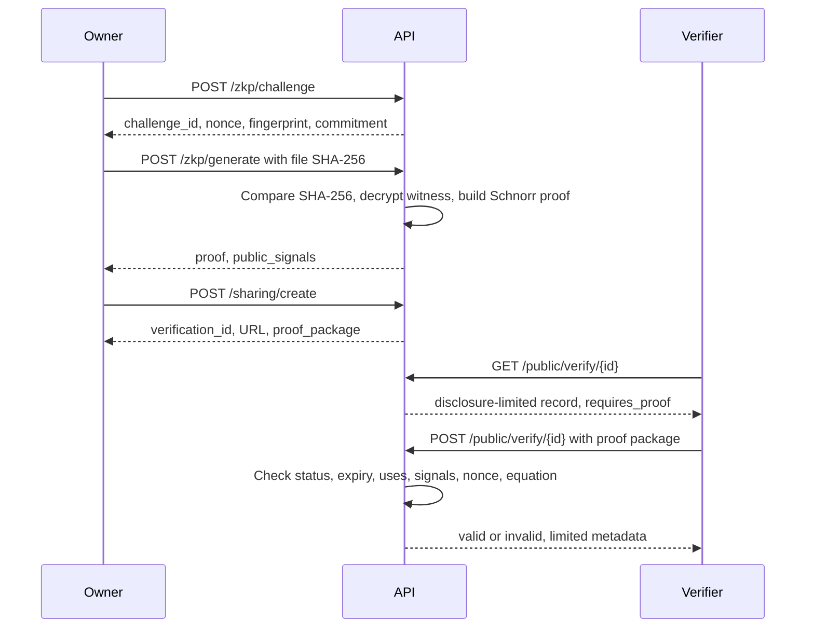

# AUTHENTIQ zero-knowledge proofs

## 1. What the runtime proof is

AUTHENTIQ uses a real non-interactive Schnorr proof of knowledge over the BN254 G1 group. The scheme identifier is:

```text
AUTHENTIQ-SCHNORR-BN254-G1-V1
```

The proof demonstrates knowledge of the opening `(s, r)` of the registered Pedersen commitment:

```text
C = sG + rH
```

where:

- `G` is the BN254 G1 generator.
- `H` is a second generator derived by hashing the label `AUTHENTIQ-PEDERSEN-H-V1` to a curve point.
- `s` is the committed ownership scalar.
- `r` is a random blinding scalar.

The proof does **not** reveal `s` or `r`. It is generated by the server from the encrypted witness associated with a registration.

## 2. Commitment construction

Let `p` be the BN254 scalar field prime:

```text
p = 21888242871839275222246405745257275088548364400416034343698204186575808495617
```

Let `F = SHA256(file)` be the 64-character hexadecimal file fingerprint. Define:

```text
fp = int(F, 16) mod p
s  = Poseidon254(fp, secret)
C  = sG + rH
```

`secret` and `r` are sampled uniformly from `[1, p-1]`. They are encrypted with Fernet before being stored. The Poseidon commitment `Poseidon254(fp, secret)` is also stored and displayed as the registration commitment.

The Poseidon implementation is pure Python and uses circomlib-compatible BN254 round constants. A known-answer check in the project verifies:

```text
Poseidon(1, 2) = 7853200120776062878684798364095072458815029376092732009249414926327459813530
```

## 3. Proof protocol

### 3.1 Setup

```text
G = BN254 G1 generator
H = hash_to_curve("AUTHENTIQ-PEDERSEN-H-V1")
C = sG + rH
```

### 3.2 Prover

Sample random `u1, u2` from the field. Compute the anchor:

```text
A = u1G + u2H
```

Compute the Fiat-Shamir challenge:

```text
c = SHA256(
      "AUTHENTIQ-SCHNORR-BN254-G1-V1" ||
      A ||
      C ||
      fingerprint ||
      registration_id ||
      nonce
    ) mod p
```

Compute responses:

```text
z1 = u1 + c * s   mod p
z2 = u2 + c * r   mod p
```

The proof is:

```json
{
  "scheme": "AUTHENTIQ-SCHNORR-BN254-G1-V1",
  "commitment": "0x...",
  "anchor": "0x...",
  "challenge": "0x...",
  "response": ["0x...", "0x..."],
  "public_signals": {
    "scheme": "AUTHENTIQ-PUBLIC-SIGNALS-V1",
    "fingerprint": "64-hex",
    "registration_id": "AUTH-2026-...",
    "commitment": "0x...",
    "challenge_nonce": "..."
  }
}
```

### 3.3 Verifier

Parse the commitment, anchor, challenge, and responses. Recompute:

```text
c' = SHA256(
       "AUTHENTIQ-SCHNORR-BN254-G1-V1" ||
       A ||
       C ||
       fingerprint ||
       registration_id ||
       nonce
     ) mod p
```

Reject if `c' != c`. Then check:

```text
z1G + z2H == A + cC
```

If the equation holds, the prover demonstrated knowledge of `(s, r)` such that `C = sG + rH`, without revealing `s` or `r`.

## 4. Why the proof is binding

The challenge includes:

- The scheme identifier, preventing cross-scheme confusion.
- The anchor, preventing anchor substitution.
- The commitment, preventing substitution of a different commitment.
- The fingerprint, binding the transcript to a specific file digest.
- The registration identifier, binding the transcript to a specific record.
- The nonce, preventing replay of an old transcript.

Because the challenge is a random-oracle hash of these values, a proof generated for one registration, fingerprint, or nonce does not verify for another. The verifier additionally checks the proof's public signals against the stored registration before accepting the proof.

## 5. What is checked outside the proof

The default proof is an opening proof for the Pedersen commitment. It does **not** contain the file or the SHA-256 compression function. The following checks happen in the application protocol outside the proof:

1. The owner selects the original file.
2. The browser and the server compute `SHA256(file)`.
3. The server compares it with the registered fingerprint using constant-time comparison.
4. The server loads the encrypted `secret` and `r` only after authorization and file-hash equality.
5. The server proves knowledge of the opening.
6. The verifier checks that the proof's fingerprint, registration reference, commitment, and nonce match the registration and challenge.
7. The verifier checks the Schnorr equation.

The proof therefore establishes **knowledge of the commitment opening**. The equality between the presented file and the registered SHA-256 fingerprint is enforced by the protocol and the server, not by constraints inside the default proof.

The runtime proof also does not independently recompute `s = Poseidon(fp, secret)`. That relation is established when the server creates the registration commitment, and the server-held witness is only released to the proving path after the file-hash check. A verifier who trusts the registration record and the application's binding checks can rely on the proof to show knowledge of the opening. A verifier who does not trust the server would need an independently published commitment and a circuit that proves the full relation.

This is the honest trust boundary of the current release.

## 6. Challenge and replay controls

- A challenge is a random URL-safe nonce with a default lifetime of 10 minutes.
- Creating a new challenge for the same user, registration, and purpose expires previous unused challenges.
- Proof generation marks the challenge as used.
- Proof verification requires the nonce and rejects unknown, expired, or already-verified challenge proofs.
- A challenge can produce at most one successful verification.
- Silent-sharing links have their own expiry (1 to 720 hours) and `max_uses` (1 to 100).
- Public verification increments the use count for every attempt and rejects revoked or expired links.
- Set `max_uses=1` for single-use verification.

Verification attempts are rate limited by IP.

## 7. Public verification flow



The public response never includes the file, the witness, the password, or the user's identity.

## 8. Optional Circom circuit

`circuits/ownership.circom` is an optional reference circuit with the relation:

```text
commitment = Poseidon(fingerprint, secret)
```

- `fingerprint` is public and is `SHA256(file) mod p`.
- `secret` is private.
- `commitment` is the public output.

The circuit can be compiled with Circom 2.1.6 and Circomlib, set up with snarkjs, and proven with Groth16. It is **not wired into the backend**. No endpoint generates or verifies Groth16 proofs, and the settings for `AUTHENTIQ_GROTH16_*` are reserved but unused.

| Property | Runtime Schnorr proof | Optional Circom circuit |
| --- | --- | --- |
| Proof system | Non-interactive Schnorr over BN254 G1 | Groth16 over Circom R1CS |
| Proves commitment opening | Yes | Yes |
| Proves Poseidon relation | No, established at registration | Yes |
| Proves SHA-256 inside circuit | No | No |
| File-hash check | Server-side before proving | Server-side before proving |
| Used by the API | Yes | No |
| Trusted setup | None | Requires a ceremony |
| Constant-time implementation | No, pure Python | Depends on proving stack |

The circuit's fingerprint input is reduced modulo `p`. A separate verifier must compute SHA-256 over the file and check the reduction. The circuit does not implement SHA-256.

## 9. Security properties and limits

### Properties

- **Completeness:** a prover with the correct witness produces a proof that verifies.
- **Soundness:** under the discrete-log assumption and the random-oracle model, a prover without the witness cannot produce an accepting transcript except with negligible probability.
- **Zero knowledge:** the proof reveals no information about `s` or `r` beyond what the commitment and public signals already reveal.
- **Context binding:** the challenge and public signals bind the proof to the fingerprint, registration, commitment, and nonce.

### Limits

- The Python curve arithmetic is not constant-time and is not hardened against timing or power side channels. It is suitable for a portable prototype, not for a hostile co-located attacker with fine-grained timing access.
- The server holds the witness and can generate proofs. The proof does not make the server trustless.
- The proof does not prove the SHA-256 preimage or the Poseidon relation in the runtime circuit.
- The Poseidon implementation is a direct Python port and has not been independently audited.
- The BN254 curve and field constants are standard, but the full protocol has not had a third-party cryptographic review.
- The optional circuit uses a development trusted setup unless replaced with a production ceremony.

## 10. Intersection with the ledger

A successful proof verification can write a ledger event. In simulation mode, this is a local hash-chained record. In Polygon mode, the event is a real Amoy testnet transaction containing identifiers and a payload digest, not the proof itself. The proof is verified by the application, not by the Solidity contract.

The ledger provides timestamp and history evidence. It does not make the ZK proof stronger and does not verify the file hash.

## 11. Verification examples

A verifier can reproduce the group equation with any BN254 library by parsing the proof's hex values and recomputing the challenge over the exact concatenation used by the server. The server uses:

```text
SHA256("|".join([scheme, anchor_hex, commitment_hex, fingerprint_lower, registration_id, nonce]))
```

and reduces the digest modulo `p`. The anchor and commitment use uncompressed 64-byte G1 coordinates encoded as 128 hex characters with a `0x` prefix. The response values are 32-byte hex field elements.

For independent verification, do not trust the application's boolean alone. Parse the group elements, recompute the challenge, and check:

```text
z1G + z2H - A - cC == identity
```

Then separately verify that the public fingerprint is the SHA-256 of the file you possess and that the registration record is the one you intend to trust.
